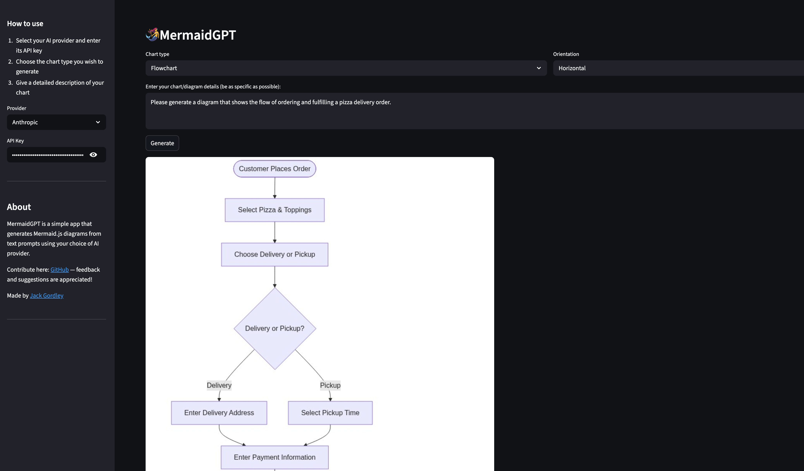

# MermaidGPT

A simple Streamlit app that turns text prompts into [Mermaid.js](https://mermaid.js.org/) diagrams using OpenAI, Anthropic, or Gemini.




## Setup

```bash
git clone https://github.com/jgordley/MermaidGPT
cd MermaidGPT
pip install -r requirements.txt
```

## Usage

```bash
streamlit run main.py
```

1. Enter your OpenAI API key in the sidebar
2. Select a chart type and orientation
3. Describe what you want to diagram
4. Click **Generate**

## How it works

- Your prompt is sent to OpenAI (gpt-4o) with instructions to return Mermaid.js markdown
- The markdown is encoded and sent to [mermaid.ink](https://mermaid.ink/) to render an image
- The image is displayed in the app alongside the raw markdown

## Files

```
main.py              # Streamlit app entry point
prompt.py            # OpenAI API call
mermaid.py           # Diagram rendering via mermaid.ink
components/
  sidebar.py         # API key input and app info
```
